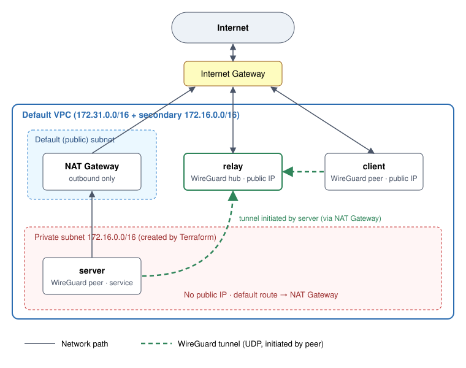

# WireGuard Relay PoC on AWS

Terraform test environment for reaching a host that has **no inbound connectivity** through a WireGuard relay.

## Problem

A host can make outbound internet connections but can't accept inbound ones, because it sits behind carrier-grade NAT or has no public IP. Services on it (e.g. SSH) can't be reached directly. Forwarding public ports through a relay works, but it exposes those services to the internet.

## Solution

- A **relay** with a public IP is the WireGuard hub.
- The **server** starts an outbound WireGuard tunnel to the relay and keeps it open.
- **Clients** join as WireGuard peers of the relay and reach the server over the tunnel.
- No service ports are forwarded on the relay's public address. Only the WireGuard UDP port is exposed.

## Architecture



| Component   | Public IP | Role                                                  |
|-------------|-----------|-------------------------------------------------------|
| relay       | yes       | WireGuard hub, routes traffic between peers           |
| client      | yes       | WireGuard peer that consumes the server's services    |
| server      | no        | Hosts the service and starts the tunnel to the relay  |
| NAT Gateway | yes       | Outbound-only path for the server (simulates CGNAT)   |

All instances run Debian Linux.

The environment uses the account's **default VPC**. Terraform:

- adds `172.16.0.0/16` to the default VPC as a secondary CIDR block
- creates the server's private subnet (`172.16.1.0/24`) from that block
- creates the private subnet's route table, with the default route pointing to the NAT Gateway

The NAT Gateway goes in an existing default (public) subnet.

## Phases

1. **Connectivity.** Build the infrastructure and set up hub-and-spoke WireGuard. The client reaches the server only through the relay.
2. **Egress lockdown (later).** The server denies all egress by default except WireGuard to the relay. All other server traffic goes through the tunnel, and the relay NATs it to the internet (plain NAT, no proxy).

## Security notes

- The relay's only public inbound port is WireGuard UDP. WireGuard doesn't respond to unauthenticated packets.
- The tunnel ends at the relay, which decrypts traffic there. Services should still use end-to-end encryption (SSH, TLS).
- Restrict forwarding on the relay: client → server only on the required ports. Block client ↔ client traffic, and don't let clients use the relay as an internet exit.
- Use one key pair per peer. To revoke access, remove the peer.
- The server needs `PersistentKeepalive` to keep its NAT mapping open.

## Usage

```sh
terraform init
terraform plan
terraform apply
terraform destroy   # when finished testing
```

## Cost

The NAT Gateway isn't covered by the AWS Free Tier. It's billed hourly plus per GB processed. Destroy the environment when you aren't testing.
